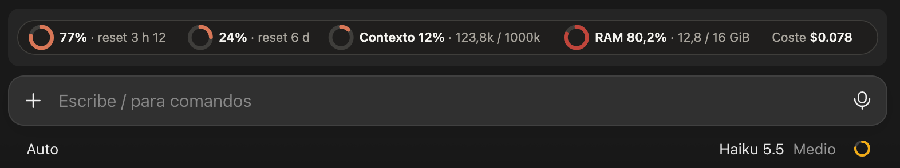

# claude-mods

Mods for [Claude Code](https://claude.com/claude-code) by Jesús García Potes.

## usage-band

Keeps your Claude usage in view while you work:

- A band above the prompt with one ring per meter: the 5-hour and 7-day usage windows with the time until each resets, the session's context fill, the RAM in use and the session cost.
- A `/consumo` pane with two cards (session cost and context) and a bar for each meter.

On the Claude Code desktop app both are drawn as graphics that follow your light or dark mode; in the terminal they fall back to text. Figures refresh every 30 seconds. The usage windows, context and cost come from the last API response, so they move as Claude answers.

The session cost is the API-equivalent figure `/cost` shows: what the session's tokens would cost at API prices. On a Pro or Max subscription you are not billed that amount; your real limits are the 5-hour and 7-day windows.

RAM in use is read on macOS, Linux and Windows, counted the way each system's own monitor counts it: Activity Monitor's "Memory Used" on macOS (`vm_stat`), total less `MemAvailable` on Linux (`/proc/meminfo`), and Task Manager's "In use" on Windows (PowerShell). Where none of them works, the RAM meter is left out.



### Install

At the prompt of a Claude Code terminal session:

```
/plugin install usage-band --marketplace jesusgpo/claude-mods
```

Answer `y` to add the marketplace, then pick a scope. From a shell:

```bash
claude plugin install usage-band --marketplace jesusgpo/claude-mods
```

### Use

The band shows on its own. Open the pane with `/consumo`.

The mod API is in early access, so a Claude Code update may need a change here.

## License

MIT
